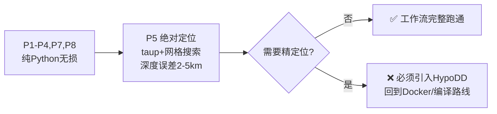

# 基于大语言模型 Agent Skills 的天然地震数据处理自动化框架：设计与实现

## 摘要

天然地震数据处理工作流涉及数据获取、震相拾取、事件关联、绝对/相对定位、震源机制反演及活动性分析等多个环节，传统上依赖研究者手动串联多种异构软件（Python 库、Fortran/C 命令行程序、Java 工具等），存在操作门槛高、流程不可复现、知识传承困难等问题。本文提出一种基于 **Agent Skills 开放标准**的天然地震数据处理自动化框架，将领域专家知识编码为结构化的技能文件（SKILL.md + 脚本 + 参考文档），使大语言模型（LLM）能够作为"智能操作员"自主执行完整的地震学工作流。框架设计了渐进式披露的文件结构、确定性的脚本封装层、以及面向离线部署的分层容器化架构，支持在国产大模型（Qwen3-Coder）上完全离线运行，满足数据安全要求。本文详细阐述了工具选型依据、Skill 文件规范、容器化开发策略及离线部署方案，为该框架的工程实现提供完整技术蓝图。

---

## 1. 研究背景与动机

### 1.1 问题陈述

天然地震学研究的数据处理链路长、工具异构性强。一个典型的从波形到高精度目录的工作流需要依次调用：

- **Python 生态**：ObsPy（数据管理）、SeisBench/PhaseNet（深度学习拾取）、PyGMT（制图）
- **Fortran/C 编译型程序**：HypoDD（双差定位）、NonLinLoc（网格搜索定位）、VELEST（速度模型反演）、CAP（矩张量反演）
- **Java 工具**：TauP（理论走时计算）
- **自写分析脚本**：完整性震级估计、Omori 衰减拟合、b 值计算

这些工具之间的数据传递依赖特定文本格式（如 HypoDD 的 phase.inp、NLL 的控制文件），格式转换逻辑散落在研究者的个人笔记或实验室内部文档中。当人员流动时，这些隐性知识随之丢失，导致新成员上手周期长达数月。

### 1.2 现有方案的不足

| 方案                    | 局限性                                                   |
| ----------------------- | -------------------------------------------------------- |
| LOC-FLOW 等自动化流水线 | 功能固定，无法根据用户意图动态调整；不含自然语言交互能力 |
| Jupyter Notebook        | 可复现但不可对话；步骤间耦合紧密，难以局部替换           |
| 传统 Shell 脚本编排     | 无错误恢复能力；无法理解用户模糊指令                     |
| 通用 LLM 直接问答       | 缺乏领域工具调用能力；易产生幻觉；无法执行实际计算       |

### 1.3 核心 Idea

**将地震学工作流编码为 Agent Skill——一种模型无关、可版本化、可离线部署的结构化知识资产。** LLM 不作为"知识库"回答地震学问题，而是作为"操作员"按照 Skill 定义的规程调用真实工具、处理真实数据、产出真实结果。

这一思路的关键洞察是：**Agent Skills 是开放标准（agentskills.io），已被 33+ Agent 产品采纳（Claude Code、OpenCode、Qwen Code 等），Skill 文件本身不绑定任何特定模型。** 这意味着同一套 Skill 可以在开发期用 Claude 调试、在生产期用国产 Qwen3-Coder 离线运行，实现"一套代码、两端复用"。

---

## 2. 工作流分析与工具选型

### 2.1 标准工作流定义

经文献调研与行业实践梳理（参照 LOC-FLOW 架构、中国地震局"谛听"智能体工具集），确定 v1 版本覆盖的核心工作流：

```
Phase 1: 数据获取        → FDSN 波形下载、台站元数据、已有目录查询
Phase 2: 数据预处理      → 去仪器响应、滤波、重采样、分量旋转
Phase 3: 事件检测与拾取  → STA/LTA 触发 或 PhaseNet 深度学习拾取
Phase 4: 震相关联        → GaMMA 高斯混合关联 或 REAL 叠加关联
Phase 5: 绝对定位        → NonLinLoc 网格搜索 或 HYPOINVERSE
Phase 6: 相对定位        → HypoDD 双差精修（ph2dt 互相关 + hypoDD 反演）
Phase 7: 震级计算        → ML 近震震级（Wood-Anderson 仿真）
Phase 8: 质检与制图      → 残差分析、G-R 关系、震中分布图、剖面图
```

v2 扩展阶段预留：VELEST 速度模型反演、CAP/HASH 震源机制、PyCSEP 活动性检验、接收函数/H-κ 地壳结构。

### 2.2 工具选型原则

1. **全开源**：排除 Antelope、SeisUnix 等商业软件
2. **纯命令行/脚本接口**：排除所有 GUI 软件，确保 LLM 可调用
3. **Linux 原生**：与容器化部署环境一致
4. **社区活跃**：优先选择有持续维护、文档完善的工具
5. **确定性封装**：Fortran/C 程序必须通过包装脚本隔离，LLM 不直接接触其输入格式

### 2.3 v1 核心工具栈

| 阶段                 | 工具                 | 类型             | 选型理由                                                     |
| -------------------- | -------------------- | ---------------- | ------------------------------------------------------------ |
| 数据获取/预处理/震级 | ObsPy                | Python 库        | 一个库覆盖 80% 数据层面需求；FDSN 客户端支持全球主要数据中心 |
| 震相拾取             | SeisBench + PhaseNet | Python (PyTorch) | SeisBench 统一多模型接口；PhaseNet 为业界事实标准            |
| 震相关联             | GaMMA                | Python           | 高斯混合模型，速度快、无需网格搜索，当前建目录主流选择       |
| 绝对定位             | NonLinLoc            | C 命令行         | 开源、文档全、配置文件驱动，适合脚本化封装                   |
| 相对定位             | HypoDD + ph2dt       | Fortran 命令行   | 引用率极高的经典程序；双差法可将定位误差降至 0.1 s           |
| 理论走时             | TauP                 | Java 命令行      | IASP91/AK135 等全球模型走时计算标准工具                      |
| 制图                 | PyGMT + Cartopy      | Python           | PyGMT 出版级地图 + GMT 沙滩球；Cartopy 交互式探索互补        |
| 活动性分析           | PyCSEP + 自写脚本    | Python           | CSEP 官方库 + scipy 自定义分析                               |

### 2.4 明确排除的工具

| 工具              | 排除原因                                          |
| ----------------- | ------------------------------------------------- |
| SeisComP 完整系统 | 服务器级实时监测系统，部署维护成本超出 Skill 范畴 |
| Earthworm         | 老牌实时系统，非主流                              |
| SPECFEM3D / SW4   | 超算级数值模拟，超出单机 Skill 能力边界           |
| 各类 GUI 解释软件 | 不符合纯命令行约束                                |

---

## 3. Skill 文件结构设计

### 3.1 设计哲学

Skill 的物理形态是一个文件夹，遵循渐进式披露（Progressive Disclosure）原则：

| 层级 | 内容                           | 加载时机                  | Token 开销                 |
| ---- | ------------------------------ | ------------------------- | -------------------------- |
| L1   | name + description             | 始终在上下文              | ~100                       |
| L2   | SKILL.md 正文                  | Agent 决定使用此 Skill 时 | ~3000–5000                |
| L3   | scripts/, references/, assets/ | 按需读取/执行             | 无上限（受上下文窗口限制） |

地球物理领域知识量大，必须充分利用 L3 层，避免 SKILL.md 膨胀导致小模型上下文溢出。

### 3.2 目录结构

```
seismic-workflow/
├── SKILL.md                        # 技能定义（唯一必需文件）
├── scripts/                        # 可执行脚本（Agent 调用，不读入上下文）
│   ├── fetch_waveforms.py          # Phase 1: 数据下载
│   ├── preprocess.py               # Phase 2: 预处理
│   ├── pick_phases.py              # Phase 3: 震相拾取
│   ├── run_association.py          # Phase 4: 关联
│   ├── run_nll_locate.sh           # Phase 5: NLL 绝对定位包装器
│   ├── run_hypodd.sh               # Phase 6: HypoDD 相对定位包装器
│   ├── compute_magnitude.py        # Phase 7: 震级计算
│   └── qc_and_plot.py              # Phase 8: 质检与制图
├── references/                     # 深度参考文档（Agent 按需阅读）
│   ├── velocity_model_guide.md     # 速度模型选择指南
│   ├── nll_input_format.md         # NLL 控制文件参数详解
│   ├── hypodd_workflow.md          # HypoDD 完整操作流程
│   └── troubleshooting.md          # 常见报错排查手册
├── assets/                         # 模板与静态资源
│   ├── nll_control_template.conf   # NLL 控制文件模板
│   ├── hypodd_inp_template.txt     # HypoDD 输入文件模板
│   ├── iasp91.tvel                 # IASP91 速度模型
│   └── report_template.md          # 处理报告模板
└── LICENSE.txt
```

### 3.3 SKILL.md 规范

#### Frontmatter（YAML 前置元数据）

```yaml
---
name: seismic-workflow
description: >
  天然地震完整处理工作流：波形下载、PhaseNet震相拾取、GaMMA关联、
  NonLinLoc绝对定位、HypoDD相对定位、目录质检与制图。
  当用户需要处理地震波形数据、构建地震目录或进行精定位时使用。
license: MIT
compatibility: Python 3.11+, GMT 6, NonLinLoc, HypoDD, Java 11+
metadata:
  author: [作者姓名]
  version: 1.0.0
  domain: seismology
---
```

`description` 是最关键字段——Agent 靠它判断何时激活此 Skill，需同时说明"做什么"和"什么时候用"。

#### 正文写作规范

| 规范                         | 理由                             |
| ---------------------------- | -------------------------------- |
| 正文 ≤500 行                | 超长内容拆入 references/         |
| 祈使句 + 编号步骤            | 小模型依赖清晰序列               |
| 每个脚本调用给出完整命令示例 | 防止模型"创造性发挥"参数         |
| 每阶段设检查点               | "确认 XX 后才进入下一步"，防跳步 |
| 写明失败处理分支             | 小模型不会自行判断异常           |
| 全部使用相对路径             | 保证可移植性                     |

### 3.4 脚本封装铁律

所有 `scripts/` 中的脚本必须遵守：

1. **Shebang + 可执行权限**：`#!/usr/bin/env python3`
2. **stdout 仅输出结构化 JSON**：Agent 解析此流；日志一律走 stderr
3. **有意义的退出码**：0 = 成功，非 0 = 失败 + 明确错误信息
4. **argparse/click 参数解析**：自带 `--help`，Agent 可探测用法
5. **零交互**：不等待键盘输入、不弹确认框
6. **Fortran/C 程序的包装器模式**：脚本负责"JSON 配置 → 生成原生输入文件 → 运行二进制 → 解析输出 → 转 JSON"，LLM 永远不直接接触 HypoDD/NLL 的古老格式

示例接口契约：

```bash
# 输入
python scripts/pick_phases.py --input data/raw/ --model phasenet --gpu

# stdout（Agent 解析）
{"status": "ok", "picks_file": "data/picks/phasenet_picks.csv", "n_events": 342, "n_picks": 4891}

# stderr（人类可读日志）
[INFO] Loading PhaseNet model from cache...
[INFO] Processing 120 stations, batch size 32...
[INFO] Completed in 4m 23s
```

---

## 4. 离线部署架构

### 4.1 架构总览

```
┌─────────────────────────────────────────────────┐
│  Layer 1: Skill 文件（模型无关，直接迁移）          │
│  seismic-workflow/SKILL.md + scripts/ + ...      │
└────────────────────┬────────────────────────────┘
                     │ 按需加载
┌────────────────────▼────────────────────────────┐
│  Layer 2: Agent 壳子（模型中立开源工具）            │
│  OpenCode / Qwen Code                            │
└────────────────────┬────────────────────────────┘
                     │ OpenAI-compatible API
                     │ http://localhost:8000/v1
┌────────────────────▼────────────────────────────┐
│  Layer 3: 本地推理引擎 + 国产模型（完全离线）        │
│  vLLM + Qwen3-Coder-30B-A3B-Instruct-FP8        │
└─────────────────────────────────────────────────┘
```

数据全程不出内网。三层解耦，任一层可独立替换。

### 4.2 模型选型

| 模型                               | 显存需求   | Agent 能力                                         | 推荐度           |
| ---------------------------------- | ---------- | -------------------------------------------------- | ---------------- |
| Qwen3-Coder-30B-A3B (MoE, 激活 3B) | FP8 ~24GB  | ⭐⭐⭐⭐⭐ 专为 agentic 编码训练，工具调用原生支持 | 🥇 首选          |
| Qwen3-32B                          | INT8 ~20GB | ⭐⭐⭐⭐ 通用能力强                                | 🥈 备选          |
| Qwen3-14B                          | ~9GB       | ⭐⭐⭐ 多步工具调用明显退化                        | 显存紧张时的下限 |
| ≤8B                               | ≤6GB      | ⭐⭐ 复杂工作流失稳                                | ❌ 不推荐        |

Qwen3-Coder-30B-A3B 为 MoE 架构，每 token 仅激活 3B 参数，推理速度接近小模型而能力远超 14B，是"既要小又要强"的最优解。

### 4.3 Agent 壳子选型

| 工具      | Skill 兼容性                                 | 本地模型支持              | 评价                      |
| --------- | -------------------------------------------- | ------------------------- | ------------------------- |
| OpenCode  | ✅ 原生支持 Agent Skills 标准，兼容 SKILL.md | ✅ 任意 OpenAI 兼容端点   | 🥇 推荐：Skill 零改动迁移 |
| Qwen Code | ✅ 类 Claude Code，支持 skills               | ✅ 官方文档支持纯内网部署 | 🥈 国产血统最纯           |

### 4.4 推理引擎

推荐使用 **vLLM**，关键启动参数：

```bash
vllm serve ./models/Qwen3-Coder-30B-A3B-Instruct-FP8 \
  --served-model-name qwen3-coder \
  --max-model-len 32768 \
  --enable-auto-tool-choice \
  --tool-call-parser hermes \
  --port 8000
```

`--tool-call-parser hermes` 必须与 Qwen3 系列匹配，否则模型输出工具调用意图但服务端无法解析。

---

## 5. 容器化开发与部署策略

### 5.1 Docker 解决的五个痛点

| 痛点         | 表现                               | Docker 解决方案                         |
| ------------ | ---------------------------------- | --------------------------------------- |
| 编译型软件   | HypoDD/NLLoc 需 gfortran，版本敏感 | 编译过程固化在镜像中                    |
| 原生科学库   | GMT 依赖 PROJ/GDAL/netCDF          | 系统包 + pip 统一装入                   |
| 静态数据依赖 | SeisBench 权重、走时表             | 打包或 volume 挂载                      |
| GPU/CUDA     | vLLM 需 NVIDIA 驱动                | nvidia-container-toolkit 共享宿主机驱动 |
| 可交付性     | 离线交付到其他单位                 | 单个 tar 文件 = 完整环境                |

### 5.2 核心原则：稳定层与变动层分离

```
稳定（很少改）                      频繁变动（天天改）
──────────────                      ────────────────
• 系统库（GMT, Java, gfortran）      • SKILL.md
• 编译好的二进制（HypoDD, NLLoc）    • scripts/*.py
• pip 包（obspy, seisbench, torch）  • references/*.md
• 模型权重（30GB）                   • 调试数据
• vLLM                               • 配置参数
        ↓                                    ↓
   镜像底层（极少 rebuild）             Bind Mount / Volume
                                      （秒级生效）
```

### 5.3 五种开发手法

#### 手法 1：Bind Mount 挂载 Skill 目录

日常开发 90% 的场景。Skill 源码在宿主机编辑，容器内实时生效：

```bash
docker run -it --rm \
  -v $(pwd)/seismic-workflow:/workspace/.opencode/skills/seismic-workflow \
  -v $(pwd)/data:/workspace/data \
  -v ~/.cache/seisbench:/root/.cache/seisbench \
  --gpus all \
  seismic-skill:dev bash
```

#### 手法 2：多阶段构建隔离编译环境

编译时需要 gfortran/gcc/make，运行时完全不需要：

```dockerfile
FROM ubuntu:22.04 AS builder
RUN apt-get update && apt-get install -y gfortran gcc make wget
WORKDIR /build
RUN wget -q https://.../HYPODD_20040930.tar.gz \
 && tar xzf HYPODD_20040930.tar.gz \
 && cd HYPODD/src && make hypoDD ph2dt

FROM python:3.11-slim
COPY --from=builder /build/HYPODD/src/hypoDD /usr/local/bin/
COPY --from=builder /build/HYPODD/src/ph2dt /usr/local/bin/
# 最终镜像不含编译器，体积小数百 MB
```

#### 手法 3：分层缓存优化 rebuild 速度

```dockerfile
# 先装依赖（稳定层，被缓存）
COPY requirements.txt /tmp/
RUN pip install --no-cache-dir -r /tmp/requirements.txt
# 后拷代码（变动层，仅此行重建）
COPY . /workspace
```

改一行 Python 脚本的 rebuild 从 20 分钟降至数秒。

#### 手法 4：Volume 持久化大文件

地震数据和模型权重绝不 COPY 进镜像：

```bash
docker volume create seisbench-weights
docker volume create seismic-data
```

#### 手法 5：Docker Compose 一键编排

```yaml
services:
  vllm:
    image: vllm/vllm-openai:latest
    deploy:
      resources:
        reservations:
          devices: [{driver: nvidia, count: all, capabilities: [gpu]}]
    volumes: ["./models:/models", "vllm-cache:/root/.cache"]
    command: >
      --model /models/Qwen3-Coder-30B-A3B-Instruct-FP8
      --served-model-name qwen3-coder
      --max-model-len 32768
      --enable-auto-tool-choice
      --tool-call-parser hermes
    ports: ["8000:8000"]

  agent:
    build: .
    depends_on: [vllm]
    environment:
      OPENAI_API_BASE: http://vllm:8000/v1
      OPENAI_API_KEY: local
    volumes:
      - ./seismic-workflow:/workspace/.opencode/skills/seismic-workflow
      - ./data:/workspace/data
      - seisbench-cache:/root/.cache/seisbench
    stdin_open: true
    tty: true

volumes:
  vllm-cache:
  seisbench-cache:
```

### 5.4 推荐的开发节奏

| 步骤               | 环境                 | 目的                     |
| ------------------ | -------------------- | ------------------------ |
| 编写/修改脚本      | 宿主机 IDE           | 利用完整编辑器体验       |
| 测试脚本链         | 容器内手动执行       | 不依赖 LLM，验证数据流通 |
| 编写/修改 SKILL.md | 宿主机 IDE           | 迭代指令表述             |
| 测试 Agent 调用    | 容器内跑 Agent       | 验证 LLM 能否正确调度    |
| 交付部署           | docker compose up -d | 一条命令起完整离线系统   |

---

## 6. 服务器环境清单

### 6.1 硬件要求

| 模式                                | 最低配置                    |
| ----------------------------------- | --------------------------- |
| 在线开发（Claude Code）             | 任意 Linux 服务器；GPU 可选 |
| 离线生产（Qwen3-Coder-30B-A3B-FP8） | NVIDIA GPU ≥24GB 显存      |

### 6.2 软件依赖完整清单

```
【系统层】
  □ NVIDIA 驱动 ≥535 + nvidia-container-toolkit
  □ gcc / gfortran / make（编译 HypoDD/NLLoc，仅构建阶段需要）
  □ Java JRE ≥11（TauP 运行时）
  □ Git, tmux

【模型服务层】
  □ Python 3.11
  □ vLLM（离线 wheel 安装）
  □ Qwen3-Coder-30B-A3B-Instruct-FP8 权重（~30GB）

【Agent 层】
  □ OpenCode 二进制（单文件，拷入即用）

【地球物理运行时】
  □ Miniforge + 专用 conda 环境
      □ obspy ≥1.4
      □ torch（CUDA 版）
      □ seisbench + 预下载权重 ★
      □ pygmt（conda-forge）
      □ cartopy, pandas, pyproj
  □ 编译产物：hypoDD, ph2dt, NLLoc
  □ TauP jar
  □ 速度模型/走时表（assets/）
```

### 6.3 易遗漏项预警

| 项目                     | 遗漏后果               | 预防措施                                      |
| ------------------------ | ---------------------- | --------------------------------------------- |
| SeisBench 预训练权重     | 离线首次拾取报下载错误 | 有网环境预跑一次，拷贝`~/.cache/seisbench/` |
| HypoDD Fortran 编译      | 定位脚本报二进制不存在 | 多阶段构建固化编译过程                        |
| vLLM tool-call-parser    | 模型能聊天但不调用工具 | 启动命令必带`--tool-call-parser hermes`     |
| nvidia-container-toolkit | `--gpus all` 不生效  | 宿主机单独安装，非 pip 包                     |

---

## 7. 纯 Python 轻量版方案（无 Docker、无编译型软件）

### 7.1 动机与假设

完整方案依赖 Docker 与编译型软件（NonLinLoc/C、HypoDD/Fortran），在以下场景构成障碍：快速原型验证、教学演示、无管理员权限的共享服务器、Windows/macOS 本地开发。本节论证一个关键假设：

> **在不使用 Docker 和编译型软件的条件下，v1 工作流能否跑通？牺牲多大？**

结论先行：**可以端到端跑通约 80% 的工作流并产出可用地震目录；唯一实质性损失集中在定位精度环节（P5/P6）**。

### 7.2 逐阶段可行性评估

| 阶段                  | 原方案                  | 纯 Python 替代                                                    | 可行性            | 牺牲               |
| --------------------- | ----------------------- | ----------------------------------------------------------------- | ----------------- | ------------------ |
| P1 数据获取           | ObsPy FDSN              | ObsPy（不变）                                                     | ✅ 完全等价       | 无                 |
| P2 预处理             | ObsPy                   | ObsPy（不变）                                                     | ✅ 完全等价       | 无                 |
| P3 震相拾取           | SeisBench/PhaseNet      | SeisBench/PhaseNet（不变）                                        | ✅ 完全等价       | 无                 |
| P4 震相关联           | GaMMA                   | GaMMA 本身即纯 Python（AI4EPS/gamma）                             | ✅ 完全等价       | 无                 |
| **P5 绝对定位** | NonLinLoc（C 编译）     | 自写网格搜索定位器：`obspy.taup` 走时 + numpy 网格搜索/最小二乘 | ⚠️ 可跑通但降级 | 见 7.3             |
| **P6 相对定位** | HypoDD/ph2dt（Fortran） | 无成熟纯 Python 实现；可自写简化版 DD 或跳过                      | ❌ 最大短板       | 见 7.3             |
| P7 震级计算           | ObsPy WA 仿真           | ObsPy（不变）                                                     | ✅ 完全等价       | 无                 |
| P8 制图质检           | PyGMT                   | 改用 Cartopy + Matplotlib                                         | ✅ 可行           | 出版级地图质量略降 |

### 7.3 两个关键降级点

#### P5 绝对定位：可行，牺牲可控

- **TauP 不需要 Java**——ObsPy 内置 `obspy.taup` 是 TauP 的纯 Python 移植，IASP91/AK135 走时计算完全覆盖，直接消除 Java 依赖。
- 用 `obspy.taup` + 一维分层速度模型做网格搜索定位是教科书级算法，数百行 numpy 即可实现。
- 牺牲清单：
  - 失去 NonLinLoc 的概率密度 PDF 输出（不确定度椭圆、边缘分布）
  - 只能用一维速度模型，无法利用三维结构 → 深度误差通常从 <2km 恶化到 2–5km
  - 无法使用 SSST 等先进改进

#### P6 相对定位：最大牺牲点

- HypoDD 是引用率最高的精定位工具，**没有维护良好的纯 Python 替代品**（经 GitHub/PyPI 核实，现有 wrapper 如 hypoDDpy 均已失效或仍依赖 Fortran 二进制）。
- 折中路径：
  1. **跳过 P6**，只交付绝对定位目录 → 相对误差停留在 ~1km 级，无法达到双差法的 0.1s/百米级；
  2. **自写简化 DD**：ph2dt 的波形互相关部分可用 numpy/scipy 实现，反演部分用稀疏最小二乘（`scipy.sparse.linalg.lsqr`）实现线性化双差 → 对小数据集（数百事件）可行，大数据集性能与收敛性无保证。
- 这是第 8.2 节"震中偏差 <1km"验证指标最可能失守的环节。

### 7.4 隐性依赖排查

| 依赖                | 是否编译型                 | 纯 Python 方案下状态                |
| ------------------- | -------------------------- | ----------------------------------- |
| GMT（PyGMT 底层库） | 二进制分发，非自行编译     | 改用 Cartopy 后完全不需要           |
| gfortran/gcc        | 仅 HypoDD/NLLoc 需要       | 放弃这两个工具后不需要              |
| Java JRE            | TauP 运行时                | `obspy.taup` 替代后不需要         |
| torch GPU           | pip wheel 自带 CUDA 运行时 | CPU 版可直接跑，拾取速度慢 5–10 倍 |

### 7.5 总体结论与架构建议



1. **假设成立**：不依赖任何编译型软件的轻量版工作流可端到端跑通，产出可用地震目录，适合原型开发、教学演示和小区域研究。
2. **核心牺牲量化**：定位精度是唯一实质损失——绝对定位深度误差放大 2–3 倍，失去相对定位能力。
3. **架构建议——可插拔定位后端**：Skill 设计上把 P5/P6 做成可插拔后端，脚本接口不变（JSON in/out），内部按环境探测：存在 `hypoDD`/`NLLoc` 二进制则调用之，否则回退到纯 Python 定位器。开发期（本机纯 Python）与生产期（容器内全功能）共用同一套 Skill，落实第 4.1 节"一套代码、两端复用"的原则。

---

## 8. 针对小模型的适配策略

离线部署使用 Qwen3-Coder-30B-A3B（激活 3B），其指令遵循能力弱于云端大模型。需在 Skill 设计中做针对性适配：

| 策略           | 具体做法                                                                         |
| -------------- | -------------------------------------------------------------------------------- |
| 指令确定性     | 避免"适当处理""合理选择"等模糊表述；改为"执行脚本 X，若输出 errors 非空则执行 Y" |
| 判断逻辑下沉   | 条件分支尽量写在脚本内部（Python），SKILL.md 只描述线性步骤序列                  |
| 检查点显式化   | 每阶段末尾写"确认 [具体文件名] 存在且大小 >0 后才进入下一阶段"                   |
| 错误处理模板化 | 为每种常见失败提供固定的重试/跳过/报告流程                                       |
| 上下文节约     | 严格遵循渐进式披露；references/ 单文件 <500KB                                    |

**验证方法**：以本地小模型为"压力测试器"——凡是它跑不稳的环节，就是 SKILL.md 写得太模糊的地方，应改为确定性脚本逻辑。

---

## 9. 预期成果与验证计划

### 9.1 交付物

1. **seismic-workflow Skill 完整源码**：SKILL.md + 8 个包装脚本 + 4 份参考文档 + 模板资源
2. **Docker 镜像**：包含完整地球物理运行时，体积 <5GB（不含模型权重）
3. **docker-compose.yml**：vLLM + OpenCode + Skill 一键部署
4. **离线部署手册**：含 pip wheel 预下载清单、SeisBench 权重迁移步骤、验证检查表

### 9.2 验证指标

| 维度             | 指标                                  | 目标                         |
| ---------------- | ------------------------------------- | ---------------------------- |
| 功能完整性       | v1 八阶段工作流端到端跑通             | 100% 阶段可自动执行          |
| 定位精度         | 与 LOC-FLOW 同数据集对比              | 震中偏差 <1km，深度偏差 <2km |
| Agent 调用成功率 | 小模型（Qwen3-Coder-30B-A3B）连续执行 | ≥90% 步骤无需人工干预       |
| 可复现性         | 不同机器相同输入相同输出              | 目录差异 <0.01s              |
| 部署时间         | 离线环境从零到可用                    | <2 小时（镜像已备好前提下）  |

### 9.3 验证数据集

选用郯庐断裂带 2024–2025 年连续波形数据（已有 LOC-FLOW 高精度目录作为 ground truth），覆盖密集台阵与稀疏台网两种场景。

---

## 10. 讨论与展望

### 10.1 本框架的定位

本框架不是要替代 LOC-FLOW 等专业流水线，而是提供一个**可对话、可扩展、可离线交付的智能操作层**。LOC-FLOW 解决"怎么算"，本框架解决"谁来调、怎么调、调错了怎么办"。二者可互补：Skill 的包装脚本内部可直接调用 LOC-FLOW 的子模块。

### 10.2 局限性

- 小模型的复杂多步推理仍有失稳风险，需持续优化 SKILL.md 的确定性
- v1 未覆盖震源机制和三维结构成像，需后续迭代
- Skill 标准仍在演进，未来可能有 breaking change

### 10.3 未来方向

- **v2 扩展**：接入 CAP/HASH 震源机制、VELEST 速度反演、PyCSEP 预测检验
- **多 Skill 协作**：将"数据预处理""定位""机制解"拆分为独立 Skill，由 Agent 按需组合
- **对接"谛听"生态**：接入中国地震局公开 API 和数据源
- **社区共建**：以开源仓库形式发布，邀请领域专家贡献各自子领域的 Skill

---

## 参考文献

1. Zhang, M., et al. (2026). High-precision earthquake catalog along the Tan-Lu Fault Zone using LOC-FLOW. *Earthquake Science*.
2. Zhu, W., & Beroza, G. C. (2019). PhaseNet: A deep-neural-network-based seismic arrival-time picking method. *Geophysical Journal International*, 216(1), 261–273.
3. McBrearty, I. W., & Beroza, G. C. (2023). Earthquake detection and association with GaMMA. *Seismological Research Letters*.
4. Waldhauser, F., & Ellsworth, W. L. (2000). A double-difference earthquake location algorithm. *Bulletin of the Seismological Society of America*, 90(6), 1353–1368.
5. Lomax, A., et al. (2000). Probabilistic earthquake location in complex three-dimensional velocity models with NonLinLoc. *Journal of Geophysical Research*.
6. Agent Skills Open Standard. (2025). agentskills.io specification.
7. 中国地震局. (2025). "谛听"地震科学智能体技术白皮书.
