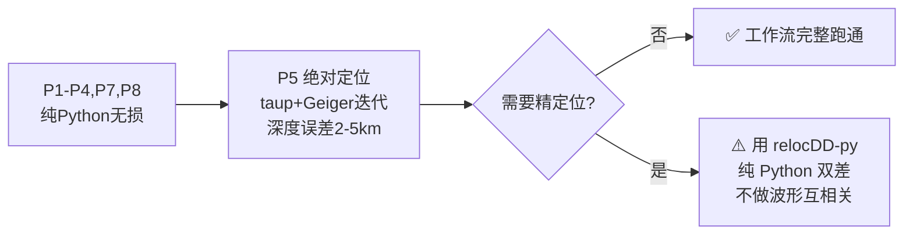

# 基于大语言模型 Agent Skills 的天然地震数据处理自动化框架：设计与实现

## 摘要

天然地震数据处理工作流涉及数据获取、震相拾取、事件关联、绝对/相对定位、震源机制反演及活动性分析等多个环节，传统上依赖研究者手动串联多种异构软件（Python 库、Fortran/C 命令行程序、Java 工具等），存在操作门槛高、流程不可复现、知识传承困难等问题。本文提出一种基于 **Agent Skills 开放标准**的天然地震数据处理自动化框架，将领域专家知识编码为结构化的技能文件（SKILL.md + 脚本 + 参考文档），使大语言模型（LLM）能够作为"智能操作员"自主执行完整的地震学工作流。框架设计了渐进式披露的文件结构、确定性的脚本封装层，以及面向离线部署的分层架构（纯 Python 运行时 + 本地推理引擎 + Agent 壳子），全流程定位与制图不依赖任何编译型软件，可在 Windows/Linux/macOS 上一致运行，支持在国产大模型（Qwen3-Coder）上完全离线运行，满足数据安全要求。本文详细阐述了工具选型依据、Skill 文件规范、开发调试策略及离线部署方案，为该框架的工程实现提供完整技术蓝图。

---

## 1. 研究背景与动机

### 1.1 问题陈述

天然地震学研究的数据处理链路长、工具异构性强。一个典型的从波形到高精度目录的工作流需要依次调用：

- **Python 生态**：ObsPy（数据管理）、SeisBench/PhaseNet（深度学习拾取）、PyGMT（制图）
- **Fortran/C 编译型程序**：HypoDD（双差定位）、NonLinLoc（网格搜索定位）、VELEST（速度模型反演）、CAP（矩张量反演）
- **Java 工具**：TauP（理论走时计算）
- **自写分析脚本**：完整性震级估计、Omori 衰减拟合、b 值计算

这些工具之间的数据传递依赖特定文本格式（如 HypoDD 的 phase.inp、NLL 的控制文件），格式转换逻辑散落在研究者的个人笔记或实验室内部文档中。当人员流动时，这些隐性知识随之丢失，导致新成员上手周期长达数月。

**本框架的应对**：把上述格式转换逻辑全部脚本化、显式化；同时凡有纯 Python 等价实现的环节（走时计算、绝对定位、双差定位）一律改用纯 Python 实现，消除编译工具链这一最大的部署障碍（详见第 7 节）。

### 1.2 现有方案的不足

| 方案                    | 局限性                                                   |
| ----------------------- | -------------------------------------------------------- |
| LOC-FLOW 等自动化流水线 | 功能固定，无法根据用户意图动态调整；不含自然语言交互能力 |
| Jupyter Notebook        | 可复现但不可对话；步骤间耦合紧密，难以局部替换           |
| 传统 Shell 脚本编排     | 无错误恢复能力；无法理解用户模糊指令                     |
| 通用 LLM 直接问答       | 缺乏领域工具调用能力；易产生幻觉；无法执行实际计算       |

### 1.3 核心 Idea

**将地震学工作流编码为 Agent Skill——一种模型无关、可版本化、可离线部署的结构化知识资产。** LLM 不作为"知识库"回答地震学问题，而是作为"操作员"按照 Skill 定义的规程调用真实工具、处理真实数据、产出真实结果。

这一思路的关键洞察是：**Agent Skills 是开放标准（agentskills.io），已被 33+ Agent 产品采纳（Claude Code、OpenCode、Qwen Code 等），Skill 文件本身不绑定任何特定模型。** 这意味着同一套 Skill 可以在开发期用 Claude 调试、在生产期用国产 Qwen3-Coder 离线运行，实现"一套代码、两端复用"。

---

## 2. 工作流分析与工具选型

### 2.1 标准工作流定义

经文献调研与行业实践梳理（参照 LOC-FLOW 架构、中国地震局"谛听"智能体工具集），确定 v1 版本覆盖的核心工作流：

```
Phase 1: 数据获取        → FDSN 波形下载、台站元数据、已有目录查询
Phase 2: 数据预处理      → 去仪器响应、滤波、重采样、分量旋转
Phase 3: 事件检测与拾取  → STA/LTA 触发 或 PhaseNet 深度学习拾取
Phase 4: 震相关联        → GaMMA 高斯混合关联 或 REAL 叠加关联
Phase 5: 绝对定位        → obspy.taup 走时 + Geiger 迭代（纯 Python）
Phase 6: 相对定位        → relocDD-py 双差定位（纯 Python：ph2dt + hypoDD）
Phase 7: 震级计算        → ML 近震震级（Wood-Anderson 仿真 + Bakun & Joyner 1984）
Phase 8: 质检与制图      → 残差分析、G-R 关系、震中分布图、剖面图
```

v2 扩展阶段预留：VELEST 速度模型反演、CAP/HASH 震源机制、PyCSEP 活动性检验、接收函数/H-κ 地壳结构。

### 2.2 工具选型原则

1. **全开源**：排除 Antelope、SeisUnix 等商业软件
2. **纯命令行/脚本接口**：排除所有 GUI 软件，确保 LLM 可调用
3. **跨平台原生**：Windows/Linux/macOS 均可直接运行，无编译型依赖
4. **社区活跃**：优先选择有持续维护、文档完善的工具
5. **确定性封装**：第三方工具（relocDD-py 等）必须通过包装脚本隔离，LLM 不直接接触其原生输入格式
6. **纯 Python 优先**：同一环节存在成熟的纯 Python 等价实现时，优先采用，避免 gfortran/Java 工具链

### 2.3 v1 核心工具栈

| 阶段                 | 工具                      | 类型             | 选型理由                                                     |
| -------------------- | ------------------------- | ---------------- | ------------------------------------------------------------ |
| 数据获取/预处理/震级 | ObsPy                     | Python 库        | 一个库覆盖 80% 数据层面需求；FDSN 客户端支持全球主要数据中心 |
| 震相拾取             | SeisBench + PhaseNet      | Python (PyTorch) | SeisBench 统一多模型接口；PhaseNet 为业界事实标准            |
| 震相关联             | GaMMA                     | Python           | 高斯混合模型，速度快、无需网格搜索，当前建目录主流选择       |
| 理论走时             | obspy.taup                | Python           | TauP 的纯 Python 移植，内置 IASP91/AK135，消除 Java 依赖     |
| 绝对定位             | Geiger 迭代（自研脚本）   | Python           | `obspy.taup` 走时 + 阻尼加权最小二乘 + Tukey 抗差，无需 C 编译 |
| 相对定位             | relocDD-py                | Python           | HypoDD 的纯 Python 移植（ph2dt + hypoDD），无需 Fortran 编译 |
| 制图                 | PyGMT + Cartopy           | Python           | PyGMT 出版级地图 + GMT 沙滩球；Cartopy 交互式探索互补        |
| 活动性分析           | PyCSEP + 自写脚本         | Python           | CSEP 官方库 + scipy 自定义分析                               |

### 2.4 明确排除的工具

| 工具                            | 排除原因                                                     |
| ------------------------------- | ------------------------------------------------------------ |
| NonLinLoc / HypoDD（原版二进制）| 需 gfortran/gcc 编译、版本敏感；功能已由纯 Python 实现覆盖   |
| TauP（Java 版）                 | 需 Java JRE；`obspy.taup` 为等价纯 Python 移植               |
| SeisComP 完整系统               | 服务器级实时监测系统，部署维护成本超出 Skill 范畴            |
| Earthworm                       | 老牌实时系统，非主流                                         |
| SPECFEM3D / SW4                 | 超算级数值模拟，超出单机 Skill 能力边界                      |
| 各类 GUI 解释软件               | 不符合纯命令行约束                                           |

---

## 3. Skill 文件结构设计

### 3.1 设计哲学

Skill 的物理形态是一个文件夹，遵循渐进式披露（Progressive Disclosure）原则：

| 层级 | 内容                           | 加载时机                  | Token 开销                 |
| ---- | ------------------------------ | ------------------------- | -------------------------- |
| L1   | name + description             | 始终在上下文              | ~100                       |
| L2   | SKILL.md 正文                  | Agent 决定使用此 Skill 时 | ~3000–5000                |
| L3   | scripts/, references/, assets/ | 按需读取/执行             | 无上限（受上下文窗口限制） |

地球物理领域知识量大，必须充分利用 L3 层，避免 SKILL.md 膨胀导致小模型上下文溢出。

### 3.2 目录结构

```
seismic-workflow/
├── SKILL.md                        # 技能定义（唯一必需文件）
├── scripts/                        # 可执行脚本（Agent 调用，不读入上下文）
│   ├── common.py                   # 公共库（JSON 契约、日志、拾取/台站读取、计时器）
│   ├── p00_detect_env.py           # Phase 0: 环境探测（packages / backends）
│   ├── p01_resolve_event.py        # Phase 1: 事件参数解析（文本 → 时间窗）
│   ├── p01_fetch_waveforms.py      # Phase 1: 数据下载（FDSN 或本地目录）
│   ├── p02_preprocess.py           # Phase 2: 去响应、滤波、重采样、分量旋转
│   ├── p03_pick_phases.py          # Phase 3: PhaseNet 震相拾取
│   ├── p04_run_association.py      # Phase 4: GaMMA 关联（事件表 + 拾取归属）
│   ├── p05_grid_locate.py          # Phase 5: 绝对定位（taup 走时 + Geiger 迭代）
│   ├── p06_run_hypodd.py           # Phase 6: 相对定位（relocDD-py 包装器）
│   ├── p07_compute_magnitude.py    # Phase 7: ML 震级计算
│   ├── p08_qc_and_plot.py          # Phase 8: 质检与制图
│   └── p99_run_pipeline.py         # P2–P8 一键流水线（含检查点校验与计时）
├── packages/                       # 第三方包安装脚本（上游缺打包文件时补 pyproject.toml）
│   └── relocdd-py/
│       ├── install.py              # git clone + 补 pyproject.toml + pip install -e
│       └── pyproject.toml
├── references/                     # 深度参考文档（Agent 按需阅读）
│   ├── velocity_model_guide.md     # 速度模型选择指南
│   ├── hypodd_workflow.md          # relocDD-py 双差定位完整操作流程
│   └── troubleshooting.md          # 常见报错排查手册
├── assets/                         # 模板与静态资源
│   ├── gamma_config.json           # GaMMA 关联参数
│   ├── iasp91.tvel                 # IASP91 速度模型（P5 走时/深度）
│   ├── relocdd_ph2dt_inp_template.txt   # ph2dt 控制文件模板
│   ├── relocdd_hypodd_inp_template.txt  # hypoDD 控制文件模板
│   └── report_template.md          # 处理报告模板
└── LICENSE.txt
```

### 3.3 SKILL.md 规范

#### Frontmatter（YAML 前置元数据）

```yaml
---
name: seismic-workflow
description: >
  天然地震完整处理工作流：波形下载、PhaseNet震相拾取、GaMMA关联、
  纯 Python Geiger 绝对定位、relocDD-py 相对定位、目录质检与制图。
  当用户需要处理地震波形数据、构建地震目录或进行精定位时使用。
license: MIT
compatibility: Python 3.11+, GMT 6（可选）, relocDD-py（纯 Python，安装阶段 git 安装，见 docs/install.md）
metadata:
  version: 1.0.0
  domain: seismology
---
```

`description` 是最关键字段——Agent 靠它判断何时激活此 Skill，需同时说明"做什么"和"什么时候用"。

#### 正文写作规范

| 规范                         | 理由                             |
| ---------------------------- | -------------------------------- |
| 正文 ≤500 行                | 超长内容拆入 references/         |
| 祈使句 + 编号步骤            | 小模型依赖清晰序列               |
| 每个脚本调用给出完整命令示例 | 防止模型"创造性发挥"参数         |
| 每阶段设检查点               | "确认 XX 后才进入下一步"，防跳步 |
| 写明失败处理分支             | 小模型不会自行判断异常           |
| 全部使用相对路径             | 保证可移植性                     |

### 3.4 脚本封装铁律

所有 `scripts/` 中的脚本必须遵守：

1. **Shebang + 可执行权限**：`#!/usr/bin/env python3`
2. **stdout 仅输出结构化 JSON**：Agent 解析此流；日志一律走 stderr
3. **有意义的退出码**：0 = 成功，非 0 = 失败 + 明确错误信息
4. **argparse/click 参数解析**：自带 `--help`，Agent 可探测用法
5. **零交互**：不等待键盘输入、不弹确认框
6. **第三方程序的包装器模式**：脚本负责"JSON 配置 → 生成原生输入文件 → 调用第三方实现 → 解析输出 → 转 JSON"，LLM 永远不直接接触 relocDD-py 的 `phase.dat` / `hypoDD.inp` 等原生格式（P6）。
7. **耗时可见**：脚本总耗时由 `common.run_main` 打到 stderr（`脚本耗时: ...`），`emit` 的 JSON 里带 `elapsed_s`；多步骤脚本用 `common.StepTimer` 逐步计时（`with timer.step("...")` + `timer.log_summary()`），循环内重复的小步骤用 `common.CumulativeTimer` 按名字累加（条目多一个 `count`），一键流水线另外把各阶段耗时写入 `data/pipeline_logs/timings.json` 并追加到 `<阶段>.log` 的 `---ELAPSED---` 段；阶段自报的 `timings` 会随该阶段进入 `timings.json`，P8 汇总进 QC 报告时按阶段展开成"内部步骤"明细

示例接口契约：

```bash
# 输入
python scripts/p03_pick_phases.py --input data/preprocessed \
  --model phasenet --output data/picks/phasenet_picks.csv

# stdout（Agent 解析）
{"status": "ok", "model": "phasenet", "device": "cuda", "n_files": 11,
 "n_traces": 33, "n_picks": 137, "n_p_picks": 79, "n_s_picks": 58,
 "picks_file": "data/picks/phasenet_picks.csv"}

# stderr（人类可读日志）
[INFO] Loading PhaseNet model from cache...
[INFO] Processing 11 files, batch size 32...
[INFO] Completed in 4m 23s
```

---

## 4. 离线部署架构

### 4.1 架构总览

```
┌─────────────────────────────────────────────────┐
│  Layer 1: Skill 文件（模型无关，直接迁移）          │
│  seismic-workflow/SKILL.md + scripts/ + ...      │
└────────────────────┬────────────────────────────┘
                     │ 按需加载
┌────────────────────▼────────────────────────────┐
│  Layer 2: Agent 壳子（模型中立开源工具）            │
│  OpenCode / Qwen Code                            │
└────────────────────┬────────────────────────────┘
                     │ OpenAI-compatible API
                     │ http://localhost:8000/v1
┌────────────────────▼────────────────────────────┐
│  Layer 3: 本地推理引擎 + 国产模型（完全离线）        │
│  vLLM + Qwen3-Coder-30B-A3B-Instruct-FP8        │
└─────────────────────────────────────────────────┘
```

数据全程不出内网。三层解耦，任一层可独立替换。

### 4.2 模型选型

| 模型                               | 显存需求   | Agent 能力                                         | 推荐度           |
| ---------------------------------- | ---------- | -------------------------------------------------- | ---------------- |
| Qwen3-Coder-30B-A3B (MoE, 激活 3B) | FP8 ~24GB  | ⭐⭐⭐⭐⭐ 专为 agentic 编码训练，工具调用原生支持 | 🥇 首选          |
| Qwen3-32B                          | INT8 ~20GB | ⭐⭐⭐⭐ 通用能力强                                | 🥈 备选          |
| Qwen3-14B                          | ~9GB       | ⭐⭐⭐ 多步工具调用明显退化                        | 显存紧张时的下限 |
| ≤8B                               | ≤6GB      | ⭐⭐ 复杂工作流失稳                                | ❌ 不推荐        |

Qwen3-Coder-30B-A3B 为 MoE 架构，每 token 仅激活 3B 参数，推理速度接近小模型而能力远超 14B，是"既要小又要强"的最优解。

### 4.3 Agent 壳子选型

| 工具      | Skill 兼容性                                 | 本地模型支持              | 评价                      |
| --------- | -------------------------------------------- | ------------------------- | ------------------------- |
| OpenCode  | ✅ 原生支持 Agent Skills 标准，兼容 SKILL.md | ✅ 任意 OpenAI 兼容端点   | 🥇 推荐：Skill 零改动迁移 |
| Qwen Code | ✅ 类 Claude Code，支持 skills               | ✅ 官方文档支持纯内网部署 | 🥈 国产血统最纯           |

### 4.4 推理引擎

推荐使用 **vLLM**，关键启动参数：

```bash
vllm serve ./models/Qwen3-Coder-30B-A3B-Instruct-FP8 \
  --served-model-name qwen3-coder \
  --max-model-len 32768 \
  --enable-auto-tool-choice \
  --tool-call-parser hermes \
  --port 8000
```

`--tool-call-parser hermes` 必须与 Qwen3 系列匹配，否则模型输出工具调用意图但服务端无法解析。

---

## 5. 开发与调试策略

### 5.1 不需要容器的三个理由

| 传统痛点     | 表现                                       | 本框架的做法                                                   |
| ------------ | ------------------------------------------ | -------------------------------------------------------------- |
| 编译型软件   | HypoDD/NLLoc 需 gfortran，版本敏感         | **不使用**：P5 为 `obspy.taup` + Geiger 迭代，P6 为 relocDD-py |
| 原生科学库   | GMT 依赖 PROJ/GDAL/netCDF                  | **可选**：PyGMT 缺失时 P8 自动回退 Cartopy + Matplotlib        |
| 静态数据依赖 | SeisBench 权重、走时表缓存                 | 缓存到 `~/.cache/seisbench/`、`seismic-workflow/.cache/`，拷贝即迁移 |

运行时依赖只剩下 pip 包加两个缓存目录，**因此不再需要容器来保证可复现性**：
同一套 Skill 在 Windows / Linux / macOS 上安装步骤完全一致（见 `docs/install.md`）。

### 5.2 核心原则：稳定层与变动层分离

```
稳定（装一次）                        频繁变动（天天改）
──────────────                        ────────────────
• pip 包（obspy, seisbench, torch）    • SKILL.md
• relocDD-py（install.py 装一次）      • scripts/*.py
• SeisBench 权重（~/.cache/seisbench） • references/*.md
• 走时表缓存（.cache/iasp91_tt_table） • 调试数据 / 配置参数
• vLLM 与模型权重                      • data/ 下的一切产物
        ↓                                      ↓
   venv / conda 环境（装一次）          直接编辑，无需重建
```

改 `scripts/` 或 `SKILL.md` 不需要重装任何依赖——这是把环境固化到容器里才能解决的问题
在纯 Python 方案下的自然消解；只有 pip 依赖或 `packages/relocdd-py` 变更时才需重新安装。

### 5.3 四种开发手法

#### 手法 1：Skill 目录就地运行

Skill 源码与数据目录同处项目根，脚本内部一律使用相对路径，Agent 的 cwd 即项目根，
无需挂载、无需拷贝：

```bash
python seismic-workflow/scripts/p99_run_pipeline.py \
  --input data/raw --workdir data --stations-dir data/stations
```

#### 手法 2：用一键流水线替代 LLM 编排

调试阶段不要经由 Agent：`p99_run_pipeline.py` 串接 P2–P8 并在每阶段校验检查点，
任一阶段失败即停并输出已完成阶段的 JSON 摘要，比多轮 LLM 调用更快、更可复现。
脚本链本身跑通后，再交给 Agent 处理需要判断的环节（数据来源、参数取舍、异常分支）。

#### 手法 3：venv 固化依赖

```bash
python -m venv .venv
.venv\Scripts\activate          # Windows（Linux/macOS: source .venv/bin/activate）
pip install -r requirements.txt
python seismic-workflow/packages/relocdd-py/install.py
```

新机器上重复这三条即可。`requirements.txt` 是依赖的唯一事实来源，
需要离线交付时用 `pip download -r requirements.txt` 预取 wheel。

#### 手法 4：大文件与缓存不入库

波形、SeisBench 权重、走时表缓存都落在 gitignore 覆盖的目录
（`data/`、`~/.cache/seisbench/`、`seismic-workflow/.cache/`、`tests/tmp_data/`），
仓库保持轻量；离线交付时单独拷贝缓存目录即可。

### 5.4 推荐的开发节奏

| 步骤               | 环境                          | 目的                     |
| ------------------ | ----------------------------- | ------------------------ |
| 编写/修改脚本      | 宿主机 IDE                    | 利用完整编辑器体验       |
| 测试脚本链         | 宿主机 venv 内手动执行 p99    | 不依赖 LLM，验证数据流通 |
| 编写/修改 SKILL.md | 宿主机 IDE                    | 迭代指令表述             |
| 测试 Agent 调用    | 宿主机跑 Agent（指向本地端点）| 验证 LLM 能否正确调度    |
| 交付部署           | 拷贝 Skill 目录 + 缓存 + 权重 | 无需重建环境             |

---

## 6. 服务器环境清单

### 6.1 硬件要求

| 模式                                | 最低配置                    |
| ----------------------------------- | --------------------------- |
| 在线开发（Claude Code）             | 任意 Linux 服务器；GPU 可选 |
| 离线生产（Qwen3-Coder-30B-A3B-FP8） | NVIDIA GPU ≥24GB 显存      |

### 6.2 软件依赖完整清单

```
【系统层】
  □ NVIDIA 驱动 ≥535（仅 GPU 推理需要；裸机部署直接使用宿主驱动）
  □ Git, tmux
  ※ 不需要 gcc/gfortran/make，也不需要 Java JRE：
    P5 用 obspy.taup、P6 用 relocDD-py，两者均为纯 Python

【模型服务层】
  □ Python 3.11
  □ vLLM（离线 wheel 安装）
  □ Qwen3-Coder-30B-A3B-Instruct-FP8 权重（~30GB）

【Agent 层】
  □ OpenCode 二进制（单文件，拷入即用）

【地球物理运行时】
  □ Miniforge + 专用 conda 环境（或 venv）
      □ obspy ≥1.4
      □ torch（CUDA 版，GPU 推理）
      □ seisbench + 预下载权重 ★
      □ pygmt（conda-forge，可选；缺失回退 Cartopy）
      □ cartopy, pandas, pyproj, scipy, numpy
      □ relocDD-py（packages/relocdd-py/install.py，P6 必需）
  □ 速度模型/走时表（assets/iasp91.tvel；走时表缓存自动生成）
```

### 6.3 易遗漏项预警

| 项目                     | 遗漏后果               | 预防措施                                      |
| ------------------------ | ---------------------- | --------------------------------------------- |
| SeisBench 预训练权重     | 离线首次拾取报下载错误 | 有网环境预跑一次，拷贝`~/.cache/seisbench/` |
| relocDD-py 未安装        | P6 被自动跳过，只交付绝对定位目录 | 安装阶段执行 `packages/relocdd-py/install.py`（见 docs/install.md） |
| vLLM tool-call-parser    | 模型能聊天但不调用工具 | 启动命令必带`--tool-call-parser hermes`     |
| nvidia-container-toolkit | 仅容器部署时需要       | 裸机 GPU 部署无需安装，直接使用宿主驱动       |

---

## 7. 全纯 Python 技术选型：依据与代价

### 7.1 动机与假设

第 2 节的选型把历史上的编译型/Java 工具（NonLinLoc/C、HypoDD/Fortran、TauP/Java）换成了纯 Python 等价实现。
做出这一取舍的动机是：**Docker 与编译工具链在快速原型验证、教学演示、无管理员权限的共享服务器、Windows/macOS 本地开发等场景下构成实际障碍**——而这些恰是本框架的主要使用场景。

> **问题：不用 Docker、不用任何编译型软件，v1 工作流能否跑通？牺牲多大？**

结论先行：**可以端到端跑通并产出可用地震目录；唯一实质性损失集中在定位精度环节（P5/P6）**。

### 7.2 逐阶段代价评估

| 阶段                  | 常规方案（被替换）      | 本框架实现                                                        | 可行性            | 代价               |
| --------------------- | ----------------------- | ----------------------------------------------------------------- | ----------------- | ------------------ |
| P1 数据获取           | ObsPy FDSN              | ObsPy（同为纯 Python）                                            | ✅ 完全等价       | 无                 |
| P2 预处理             | ObsPy                   | ObsPy（同为纯 Python）                                            | ✅ 完全等价       | 无                 |
| P3 震相拾取           | SeisBench/PhaseNet      | SeisBench/PhaseNet（同为纯 Python）                               | ✅ 完全等价       | 无                 |
| P4 震相关联           | GaMMA                   | GaMMA 本身即纯 Python（AI4EPS/gamma）                             | ✅ 完全等价       | 无                 |
| **P5 绝对定位** | NonLinLoc（C 编译）     | 自写 Geiger 迭代定位器：`obspy.taup` 走时 + 阻尼加权最小二乘 | ⚠️ 可跑通但降级 | 见 7.3             |
| **P6 相对定位** | HypoDD/ph2dt（Fortran） | relocDD-py：HypoDD 的纯 Python 移植（安装阶段 git 安装，不做波形互相关） | ⚠️ 可跑通但降级 | 见 7.3             |
| P7 震级计算           | ObsPy WA 仿真           | ObsPy（同为纯 Python，Bakun & Joyner 1984 标定式）                | ✅ 完全等价       | 无                 |
| P8 制图质检           | PyGMT + Cartopy         | 首选 PyGMT，GMT 缺失时回退 Cartopy + Matplotlib                   | ✅ 可行           | 出版级地图质量略降 |

### 7.3 两个关键降级点

#### P5 绝对定位：可行，牺牲可控

- **TauP 不需要 Java**——ObsPy 内置 `obspy.taup` 是 TauP 的纯 Python 移植，IASP91/AK135 走时计算完全覆盖，直接消除 Java 依赖。
- 用 `obspy.taup` + 一维分层速度模型做 Geiger 迭代定位是教科书级算法，数百行 numpy 即可实现（无需网格穷举，单事件约 1 s）。
- 牺牲清单：
  - 失去 NonLinLoc 的概率密度 PDF 输出（不确定度椭圆、边缘分布）
  - 只能用一维速度模型，无法利用三维结构 → 深度误差通常从 <2km 恶化到 2–5km
  - 无法使用 SSST 等先进改进

#### P6 相对定位：可用纯 Python 后端，精度降级

- 后端改用 **relocDD-py**（HypoDD 的纯 Python 移植，GPL-3.0），无需编译型 Fortran 二进制；
  由 `packages/relocdd-py/install.py` 在安装阶段从 git 安装（上游无 `pyproject.toml`，见 `docs/install.md`）。
- 降级点：relocDD-py 的 ph2dt **只基于目录拾取做差分走时，不做波形互相关**，
  因此精度低于完整 HypoDD（波形互相关 + 反演），但仍显著优于绝对定位。
- 若未安装 relocDD-py（`backends.hypodd == false`），则跳过 P6，只交付绝对定位目录 →
  相对误差停留在 ~1km 级，无法达到双差法的 0.1s/百米级。
- 这是第 8.2 节"震中偏差 <1km"验证指标最可能失守的环节。

### 7.4 隐性依赖排查

| 依赖                | 是否编译型                 | 纯 Python 方案下状态                |
| ------------------- | -------------------------- | ----------------------------------- |
| GMT（PyGMT 底层库） | 二进制分发，非自行编译     | 改用 Cartopy 后完全不需要           |
| gfortran/gcc        | 仅 HypoDD/NLLoc 需要       | 放弃这两个工具后不需要              |
| Java JRE            | TauP 运行时                | `obspy.taup` 替代后不需要         |
| torch GPU           | pip wheel 自带 CUDA 运行时 | CPU 版可直接跑，拾取速度慢 5–10 倍 |

### 7.5 总体结论与架构建议



1. **假设成立**：不依赖任何编译型软件的轻量版工作流可端到端跑通，产出可用地震目录，适合原型开发、教学演示和小区域研究。
2. **核心牺牲量化**：定位精度是唯一实质损失——绝对定位用一维速度模型，深度误差放大 2–3 倍；P6 用 relocDD-py（ph2dt 不做波形互相关），精度低于完整 HypoDD。
3. **架构建议——纯 Python 定位层**：Skill 把 P5/P6 分别固定在单一实现上——P5 为 `obspy.taup` 走时 + Geiger 迭代定位器，P6 为 relocDD-py；脚本接口不变（JSON in/out），不再做二进制探测与多后端分派。开发期与生产期共用同一套 Skill，落实第 4.1 节"一套代码、两端复用"的原则。

---

## 8. 针对小模型的适配策略

离线部署使用 Qwen3-Coder-30B-A3B（激活 3B），其指令遵循能力弱于云端大模型。需在 Skill 设计中做针对性适配：

| 策略           | 具体做法                                                                         |
| -------------- | -------------------------------------------------------------------------------- |
| 指令确定性     | 避免"适当处理""合理选择"等模糊表述；改为"执行脚本 X，若输出 errors 非空则执行 Y" |
| 判断逻辑下沉   | 条件分支尽量写在脚本内部（Python），SKILL.md 只描述线性步骤序列                  |
| 检查点显式化   | 每阶段末尾写"确认 [具体文件名] 存在且大小 >0 后才进入下一阶段"                   |
| 错误处理模板化 | 为每种常见失败提供固定的重试/跳过/报告流程                                       |
| 上下文节约     | 严格遵循渐进式披露；references/ 单文件 <500KB                                    |

**验证方法**：以本地小模型为"压力测试器"——凡是它跑不稳的环节，就是 SKILL.md 写得太模糊的地方，应改为确定性脚本逻辑。

---

## 9. 预期成果与验证计划

### 9.1 交付物

1. **seismic-workflow Skill 完整源码**：SKILL.md + 8 个包装脚本 + 4 份参考文档 + 模板资源
2. **Docker 镜像**：包含完整地球物理运行时，体积 <5GB（不含模型权重）
3. **docker-compose.yml**：vLLM + OpenCode + Skill 一键部署
4. **离线部署手册**：含 pip wheel 预下载清单、SeisBench 权重迁移步骤、验证检查表

### 9.2 验证指标

| 维度             | 指标                                  | 目标                         |
| ---------------- | ------------------------------------- | ---------------------------- |
| 功能完整性       | v1 八阶段工作流端到端跑通             | 100% 阶段可自动执行          |
| 定位精度         | 与 LOC-FLOW 同数据集对比              | 震中偏差 <1km，深度偏差 <2km |
| Agent 调用成功率 | 小模型（Qwen3-Coder-30B-A3B）连续执行 | ≥90% 步骤无需人工干预       |
| 可复现性         | 不同机器相同输入相同输出              | 目录差异 <0.01s              |
| 部署时间         | 离线环境从零到可用                    | <2 小时（镜像已备好前提下）  |

### 9.3 验证数据集

选用郯庐断裂带 2024–2025 年连续波形数据（已有 LOC-FLOW 高精度目录作为 ground truth），覆盖密集台阵与稀疏台网两种场景。

---

## 10. 讨论与展望

### 10.1 本框架的定位

本框架不是要替代 LOC-FLOW 等专业流水线，而是提供一个**可对话、可扩展、可离线交付的智能操作层**。LOC-FLOW 解决"怎么算"，本框架解决"谁来调、怎么调、调错了怎么办"。二者可互补：Skill 的包装脚本内部可直接调用 LOC-FLOW 的子模块。

### 10.2 局限性

- 小模型的复杂多步推理仍有失稳风险，需持续优化 SKILL.md 的确定性
- v1 未覆盖震源机制和三维结构成像，需后续迭代
- Skill 标准仍在演进，未来可能有 breaking change

### 10.3 未来方向

- **v2 扩展**：接入 CAP/HASH 震源机制、VELEST 速度反演、PyCSEP 预测检验
- **多 Skill 协作**：将"数据预处理""定位""机制解"拆分为独立 Skill，由 Agent 按需组合
- **对接"谛听"生态**：接入中国地震局公开 API 和数据源
- **社区共建**：以开源仓库形式发布，邀请领域专家贡献各自子领域的 Skill

---

## 参考文献

1. Zhang, M., et al. (2026). High-precision earthquake catalog along the Tan-Lu Fault Zone using LOC-FLOW. *Earthquake Science*.
2. Zhu, W., & Beroza, G. C. (2019). PhaseNet: A deep-neural-network-based seismic arrival-time picking method. *Geophysical Journal International*, 216(1), 261–273.
3. McBrearty, I. W., & Beroza, G. C. (2023). Earthquake detection and association with GaMMA. *Seismological Research Letters*.
4. Waldhauser, F., & Ellsworth, W. L. (2000). A double-difference earthquake location algorithm. *Bulletin of the Seismological Society of America*, 90(6), 1353–1368.
5. Lomax, A., et al. (2000). Probabilistic earthquake location in complex three-dimensional velocity models with NonLinLoc. *Journal of Geophysical Research*.
6. Agent Skills Open Standard. (2025). agentskills.io specification.
7. 中国地震局. (2025). "谛听"地震科学智能体技术白皮书.
