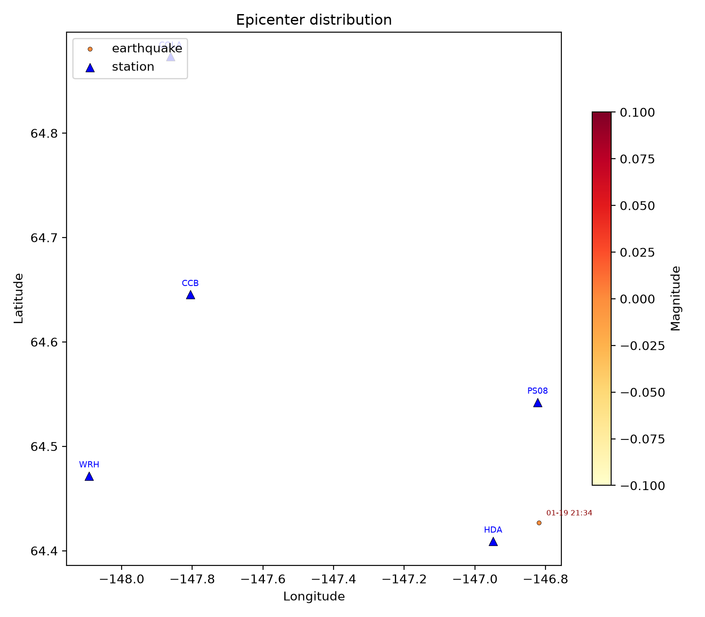
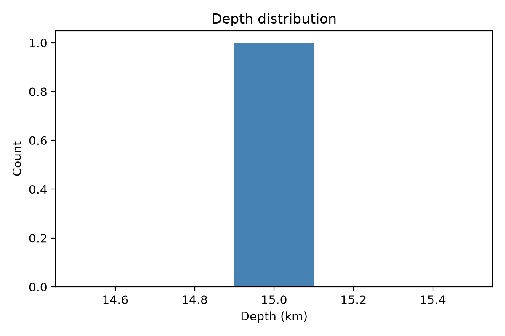
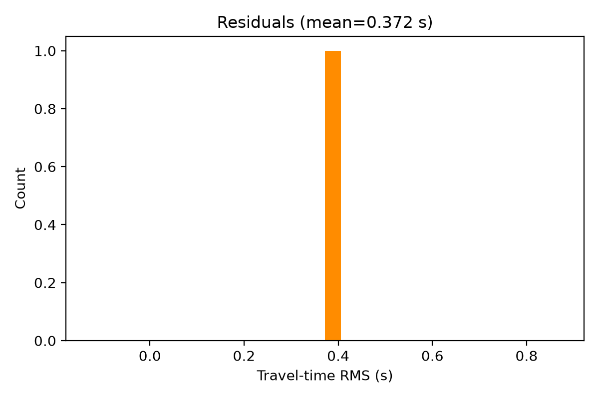
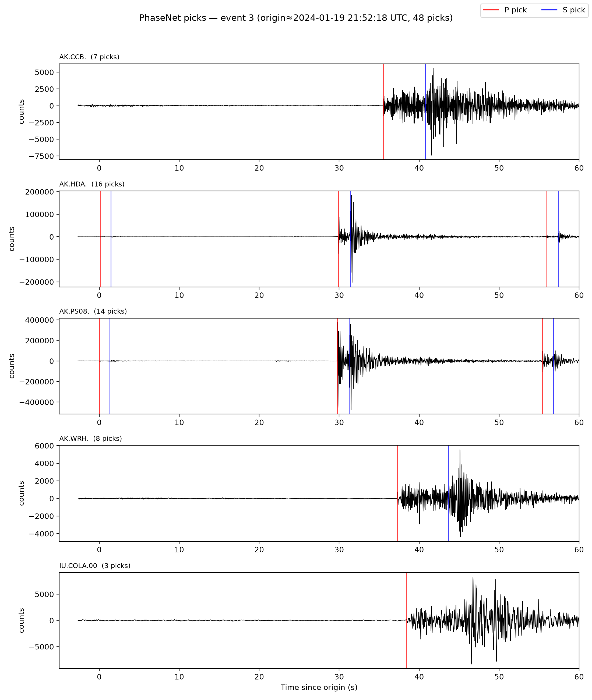

# 地震目录处理报告

## 概要
- **事件总数**: 1
- **台站数**: 5
- **有震级的事件数**: 0 (0%)
- **制图后端**: matplotlib
- **定位后端备注**: 见 SKILL.md Phase 5/6

## 统计
- 中位深度: 15.0 km
- 震级范围: N/A – N/A
- 完整性震级 Mc: N/A
- b 值: N/A
- 平均走时残差: 0.372 s

## 图件

## 注意事项
- 若未做仪器响应去除，ML 震级不可用（见 Phase 2/7 说明）。
- 纯 Python 定位后端深度误差典型为 2–5 km；如需亚公里级精度请使用 HypoDD。
