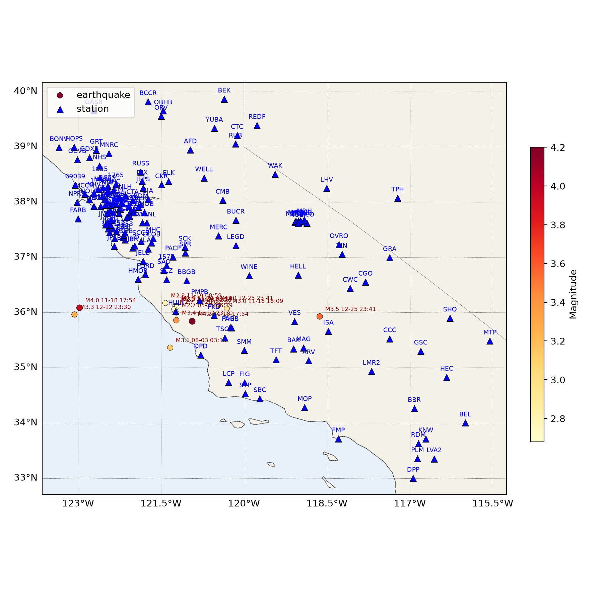
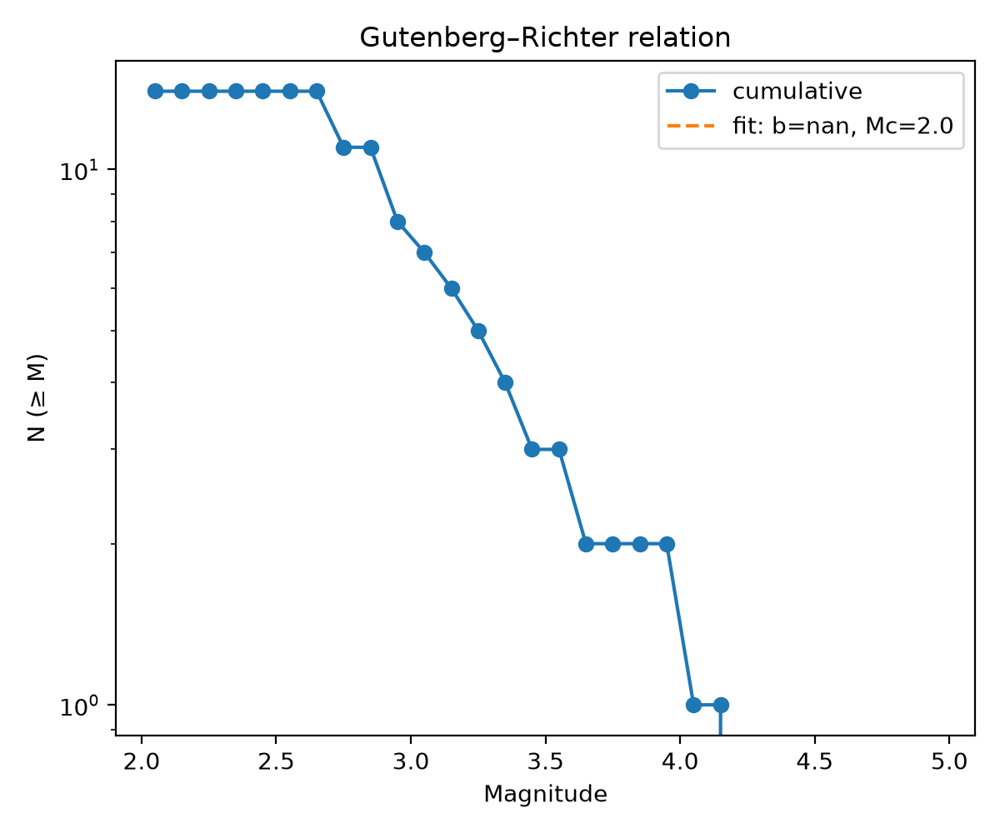
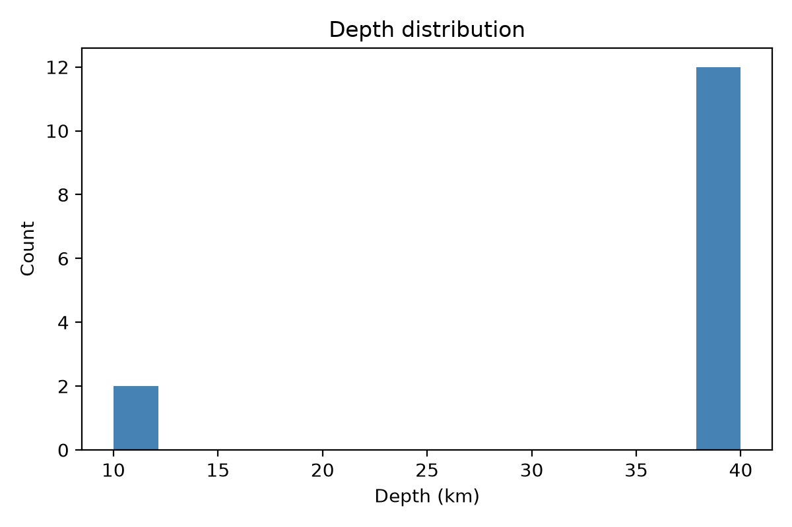
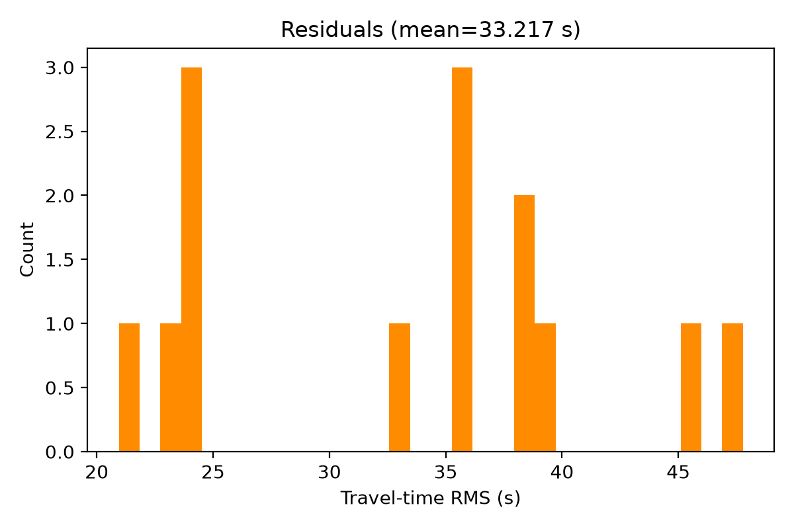

# 地震目录处理报告

## 概要
- **事件总数**: 14
- **台站数**: 157
- **有震级的事件数**: 14 (100%)
- **制图后端**: cartopy
- **底图图层**: ocean, land, coastline, country_borders, province_borders
- **定位后端备注**: 见 SKILL.md Phase 5/6

## 统计
- 中位深度: 40.0 km
- 震级范围: 2.68 – 4.2
- 完整性震级 Mc: 2.05
- b 值: nan
- 平均走时残差: 33.217 s

## 图件

## 注意事项
- 若未做仪器响应去除，ML 震级不可用（见 Phase 2/7 说明）。
- 纯 Python 定位后端深度误差典型为 2–5 km；如需亚公里级精度请使用 relocDD-py 相对定位。
