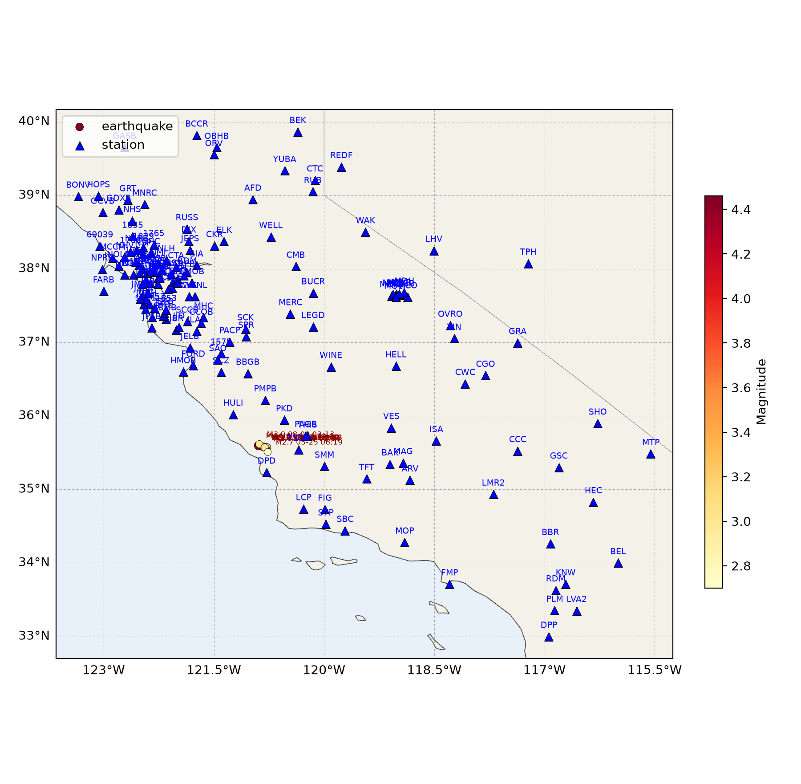
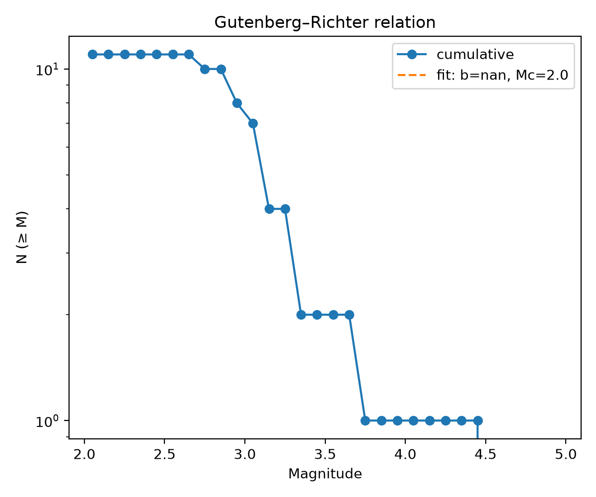
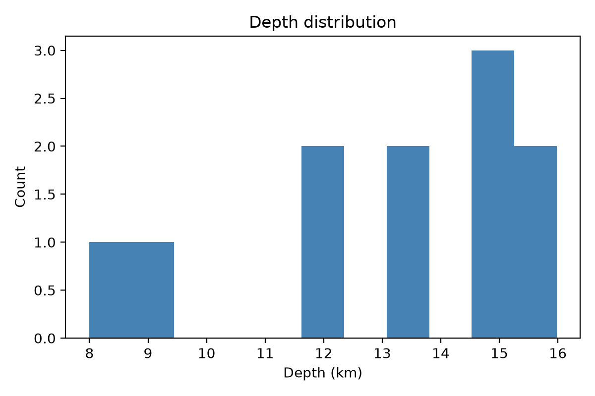
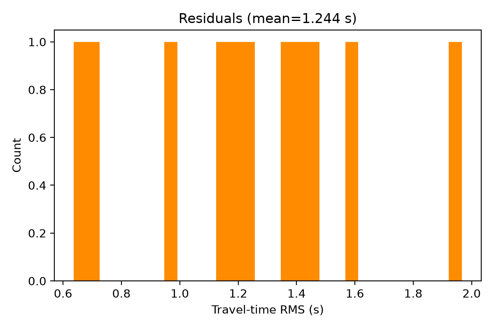

# 地震目录处理报告

生成时间: 2026-10-12 17:25 UTC

## 概要
- **事件总数**: 11
- **台站数**: 157（10 个台网）
- **有震级的事件数**: 11 (100%)
- **目录时间范围**: 2025-11-18 17:54 – 2026-08-03 03:13 UTC
- **制图后端**: cartopy
- **底图图层**: ocean, land, coastline, country_borders, province_borders
- **定位后端备注**: 见 SKILL.md Phase 5/6

## 统计
- 深度: 中位 13.6 km，范围 8.0 – 16.0 km
- 震级 (ML): 范围 2.70 – 4.46，中位 3.03，均值 3.19
- 完整性震级 Mc: 2.05（b 值 N/A（样本量不足））
- 走时残差 RMS: 均值 1.244 s，中位 1.222 s，最大 1.966 s
  （目录 `rms_s` 反映定位所用拾取的绝对时刻离散水平，量级偏大时以台站数与方位覆盖作为主要质量依据）
- 单事件平均: 台站 155 个 / 参与道 340 条 / 拾取 35 条
- 单台 ML 异常剔除: 1071 条道（偏离中位 0.5 级以上）

## 耗时（timing）

| 阶段 | 耗时 | 占比 |
|---|---|---|
| P2 预处理 | 1 m 09 s | 42.8% |
| P3 相位拾取 | 17.80 s | 11.0% |
| P4 事件关联 | 5.09 s | 3.2% |
| P5 绝对定位 | 1.77 s | 1.1% |
| P6 相对定位 | 2.42 s | 1.5% |
| P7 震级计算 | 41.80 s | 25.9% |
| P8 质检与制图（本阶段） | 23.39 s | 14.5% |
| **合计** | **2 m 41 s** | 100.0% |

**各阶段内部步骤**（同一阶段内多次调用会累加，`×N` 为调用次数）

- **P2 预处理** 内部步骤：read mseed ×11 1.28 s、detrend linear ×5002 6.38 s、demean ×5002 5.06 s、remove response ×5002 38.44 s、bandpass filter ×5002 10.71 s、write mseed ×11 2.42 s
- **P8 质检与制图（本阶段）** 内部步骤：P8 epicenter map 2.26 s、P8 G-R relation 0.29 s、P8 depth histogram 0.15 s、P8 residuals 0.15 s、P8 pick samples 20.52 s

> P2–P7 为流水线运行器（`p99_run_pipeline.py` / `tests/verify_skill.py`）测得的各阶段子进程墙钟时间（写入 `data/pipeline_logs/timings.json`，各阶段明细另见同目录 `<阶段>.log` 末尾的 `---ELAPSED---`）；P8 一行为本脚本内部计时（不含解释器启动与报告写入本身），其内部步骤见上方明细。

## 事件目录与震级

| 事件 | 发震时刻 (UTC) | 纬度 | 经度 | 深度 (km) | ML | 台站数 | 参与道数 | 拾取数 | RMS (s) | 质量 |
|---|---|---|---|---|---|---|---|---|---|---|
| ev000001 | 2025-11-18 17:54:30 | 35.5968 | -120.8934 | 8.0 | 4.46 | 157 | 303 | 92 | 1.22 | 好 |
| ev000002 | 2025-12-12 23:30:31 | 35.5786 | -120.8215 | 13.6 | 3.69 | 155 | 299 | 56 | 1.37 | 好 |
| ev000003 | 2025-11-19 09:00:12 | 35.5700 | -120.8145 | 14.8 | 3.26 | 156 | 301 | 37 | 1.18 | 好 |
| ev000004 | 2025-12-25 23:41:47 | 35.5682 | -120.7987 | 15.5 | 3.21 | 149 | 287 | 24 | 1.97 | 好 |
| ev000005 | 2025-11-21 09:18:26 | 35.5734 | -120.7755 | 16.0 | 3.08 | 156 | 301 | 34 | 0.97 | 好 |
| ev000006 | 2025-11-20 23:54:58 | 35.5698 | -120.7969 | 14.7 | 3.03 | 157 | 303 | 27 | 1.17 | 好 |
| ev000007 | 2026-08-03 03:13:58 | 35.6153 | -120.8814 | 8.7 | 3.01 | 151 | 291 | 24 | 0.70 | 好 |
| ev000008 | 2025-11-20 02:58:17 | 35.5707 | -120.7764 | 12.0 | 2.83 | 157 | 555 | 32 | 1.46 | 好 |
| ev000009 | 2025-11-20 02:56:15 | 35.5610 | -120.7926 | 11.9 | 2.83 | 157 | 501 | 24 | 1.59 | 好 |
| ev000010 | 2025-11-18 18:09:47 | 35.5696 | -120.8078 | 14.8 | 3.00 | 157 | 303 | 17 | 0.64 | 好 |
| ev000011 | 2026-05-25 06:19:17 | 35.5092 | -120.7680 | 13.3 | 2.70 | 152 | 293 | 22 | 1.43 | 好 |

> 台站数 / 参与道数 取自 p07 单台震级诊断（无诊断记录时回退为目录中的 `n_stations_used`；后者统计的是保留道数，可能大于台站数）。
> 质量分级：台站数 ≥ 8 且方位角间隙 ≤ 180° → 好；台站数 ≥ 5 → 一般；台站数 < 5 或方位角间隙 > 270° → 待查；目录缺震级 → 无震级。

## 单台震级质控

| 事件 | 单台 ML 范围 | 单台 ML 中位 | 单台 ML 标准差 | 剔除道数 | 震中距 (km) | 方位角间隙 (°) |
|---|---|---|---|---|---|---|
| ev000001 | 3.59 – 5.37 | 4.45 | 0.25 | 43 | 41.7 – 483.3 | 154.8 |
| ev000002 | 0.43 – 4.86 | 3.70 | 0.24 | 49 | 38.6 – 482.9 | 144.7 |
| ev000003 | 2.50 – 4.92 | 3.27 | 0.23 | 45 | 37.6 – 484.1 | 144.0 |
| ev000004 | 0.42 – 4.66 | 3.18 | 0.26 | 84 | 37.3 – 484.7 | 141.4 |
| ev000005 | 0.43 – 4.34 | 3.07 | 0.27 | 69 | 37.9 – 484.9 | 137.5 |
| ev000006 | 0.49 – 4.91 | 3.05 | 0.26 | 72 | 37.5 – 484.6 | 141.1 |
| ev000007 | 0.78 – 4.26 | 2.99 | 0.27 | 77 | 43.5 – 482.2 | 151.9 |
| ev000008 | -1.32 – 4.81 | 2.81 | 0.28 | 191 | 37.5 – 485.2 | 137.7 |
| ev000009 | 0.05 – 4.80 | 2.80 | 0.29 | 197 | 36.5 – 485.7 | 140.7 |
| ev000010 | 1.52 – 4.81 | 2.97 | 0.28 | 117 | 37.5 – 484.3 | 142.9 |
| ev000011 | -9.23 – 4.23 | 2.74 | 0.28 | 127 | 30.7 – 491.8 | 137.6 |

> 单台 ML 范围为逐道结果，未剔除离群；中位/标准差为剔除偏离中位 0.5 级以上的道之后的结果，与目录最终 ML 的口径一致。
> 方位角间隙由台站经纬度计算，仅统计能在台站表中匹配到坐标的台站。

## 数据完整性检查

- ✅ event_id 唯一：通过
- ✅ 经纬度完整：通过
- ✅ 深度完整：通过
- ✅ 震级完整：通过
- ✅ 坐标范围合理：通过
- ✅ 发震时刻无重复：通过
- ✅ 参与台站 ≥ 3：通过

## 输入数据

- 事件目录: `data/locate/catalog_final.csv`（11 个事件）
- 台站表: `data/stations/stations.csv`（157 个台站，10 个台网）
- 拾取文件: `data/picks/phasenet_picks.csv`（644 条：P 471，S 173）
- 波形目录: `data/preprocessed`（拾取样例图）
- 震级诊断: `catalog_final.magnitude_diag.csv`（3737 条单台记录）

## 图件

> 拾取样例图为聚类事件 #0（x 轴起点为该簇最早拾取 t0），窗口 207.2 s（自动按事件跨度取）；绘制了 109/109 个台站、124 条拾取。
